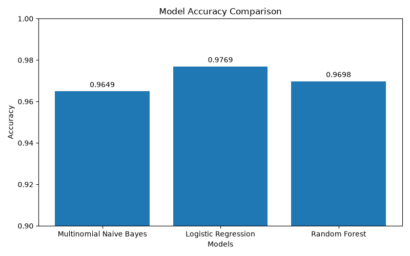
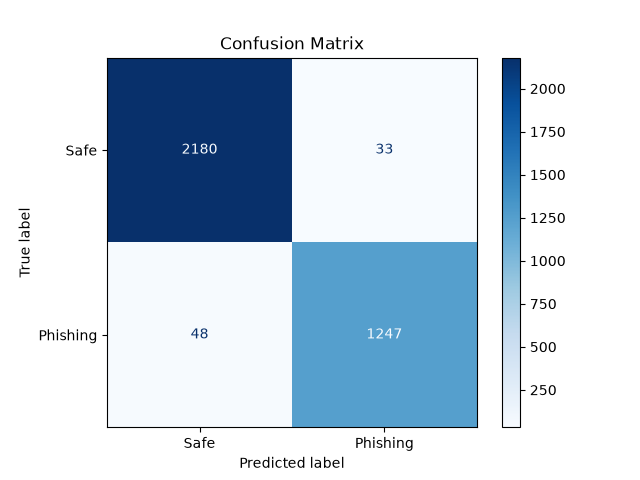

# 🛡️ Phishing Email Detection using Machine Learning

A Machine Learning-based phishing email detection system developed using Python and Scikit-learn. This project classifies emails as **Safe** or **Phishing** by analyzing their textual content using **TF-IDF Vectorization** and multiple Machine Learning algorithms.

The project was developed as part of the **Thiranex Cybersecurity Internship** to demonstrate the application of Machine Learning in cybersecurity.

---

## 📑 Table of Contents

- [📌 Features](#-features)
- [🛠️ Technologies Used](#️-technologies-used)
- [📂 Project Structure](#-project-structure)
- [⚙️ Installation](#️-installation)
- [📁 Dataset](#-dataset)
- [🌐 Web Interface](#-web-interface)
- [🚀 Usage](#-usage)
- [📊 Machine Learning Models Compared](#-machine-learning-models-compared)
- [📈 Model Performance](#-model-performance)
- [📸 Results](#-results)
- [📚 Concepts Used](#-concepts-used)
- [🎯 Learning Outcomes](#-learning-outcomes)
- [🚀 Future Enhancements](#-future-enhancements)
- [⚠️ Disclaimer](#️-disclaimer)
- [👨‍💻 Author](#-author)
- [⭐ Support](#-support)

---

## 📌 Features

- 📧 Detects whether an email is **Safe** or **Phishing**
- 🧹 Data preprocessing and cleaning
- 🔤 TF-IDF text feature extraction
- 🤖 Trains and compares multiple ML algorithms
- 📊 Model evaluation using:
  - Accuracy
  - Precision
  - Recall
  - F1-Score
  - Confusion Matrix
- 🏆 Automatically selects the best-performing model
- 💾 Saves the trained model using Joblib
- ⚡ Interactive email prediction script
- 📈 Model accuracy comparison graph
- 📉 Confusion matrix visualization

---

## 🛠️ Technologies Used

- Python
- Pandas
- NumPy
- Scikit-learn
- Matplotlib
- Seaborn
- Joblib

---

## 📂 Project Structure

```
Phishing-Email-Detection/
│
├── dataset/
│   └── Phishing_Email.csv
│
├── model/
│   ├── phishing_model.pkl
│   └── tfidf_vectorizer.pkl
│
├── screenshots/
│   ├── confusion_matrix.png
│   └── model_comparison.png
│
├── utils/                    ← shared utilities
│   ├── __init__.py
│   ├── paths.py              ← central path configuration
│   └── data_loader.py        ← shared data loading & cleaning
│
├── train_model.py
├── test_model.py
├── phishing_detector.py
├── requirements.txt
├── README.md
└── .gitignore
```

---

## ⚙️ Installation

### 1. Clone the Repository

```bash
git clone https://github.com/vinayak-30-debug/Phishing-Email-Detection.git

cd Phishing-Email-Detection
```

### 2. Create Virtual Environment

Windows

```bash
python -m venv venv
venv\Scripts\activate
```

Linux/macOS

```bash
python3 -m venv venv
source venv/bin/activate
```

### 3. Install Dependencies

```bash
pip install -r requirements.txt
```

---

## 📁 Dataset

This project uses the **Phishing Email Dataset**, containing both legitimate and phishing emails for binary classification.

Columns:

- Email Text
- Email Type

---

## 🌐 Web Interface

A Streamlit web app is included for browser-based predictions.

```bash
streamlit run app.py
```

Features:
- Paste any email text and get an instant Safe / Phishing verdict
- Confidence breakdown (phishing probability, safe probability, risk meter)
- Safety tips shown when a phishing email is detected

---

## 🚀 Usage

### Train the Model

```bash
python train_model.py
```

The script will:

- Load and clean the dataset
- Convert text into TF-IDF features
- Train multiple ML models
- Evaluate each model
- Select the best model
- Save the trained model
- Generate evaluation graphs

---

### Predict an Email

```bash
python phishing_detector.py
```

Example:

```
============================================================
       🛡️  Phishing Email Detector
============================================================

Paste the email text below.
When done, press Enter on a blank line:

Congratulations!
You have won $10,000.
Click here to claim your reward.

```

Output

```
============================================================
🚨 Result     : Phishing Email
📊 Confidence : 98.47%
============================================================
```

---

## 📊 Machine Learning Models Compared

- Logistic Regression
- Multinomial Naive Bayes
- Random Forest Classifier

The best-performing model is automatically selected based on accuracy.

---

## 📈 Model Performance

**Best Model**

```
Logistic Regression
```

**Accuracy**

```
97.69%
```

**Training Samples**

```
14030
```

**Testing Samples**

```
3508
```

Example Confusion Matrix

```
[[2148   65]
 [  41 1254]]
```

---

## 📸 Results

### Model Accuracy Comparison



---

### Confusion Matrix



## 📚 Concepts Used

- Machine Learning
- Text Classification
- Natural Language Processing (NLP)
- TF-IDF Vectorization
- Data Preprocessing
- Feature Extraction
- Model Evaluation
- Binary Classification
- Cybersecurity

---

## 🎯 Learning Outcomes

Through this project, I learned:

- Data preprocessing techniques
- Text feature extraction using TF-IDF
- Training and evaluating multiple ML models
- Comparing model performance
- Saving trained ML models
- Building a phishing email prediction system
- Applying Machine Learning in cybersecurity

---

## 🚀 Future Enhancements

- Deep Learning (LSTM/BERT)
- Email URL analysis
- Attachment scanning
- Real-time email monitoring
- ~~Web interface using Flask or Streamlit~~ ✅ Done — `app.py`
- Email header analysis
- API deployment

---

## ⚠️ Disclaimer

This project is developed solely for educational and research purposes as part of the Thiranex Cybersecurity Internship.

---

## 👨‍💻 Author

**Vinayak D**

Computer Science Engineering Student

Cybersecurity & Data Science Enthusiast

GitHub:
https://github.com/vinayak-30-debug


---

## ⭐ Support

If you found this project useful, consider giving it a ⭐ on GitHub.